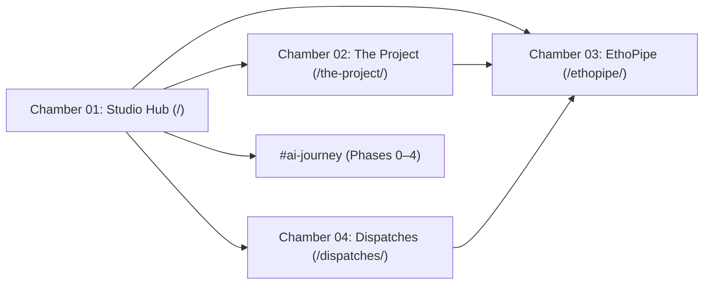

# DESIGN.md — The Transparency Project & EthoPipe Design System

> **Canonical Web Domain:** https://thetransparencyproject.me/  
> **Documentation Portal:** https://docs.thetransparencyproject.me  
> **System Version:** `v0.2.0` · **Appearance Mode:** Strict Dark (`class="dark"`)  
> **Principal Systems Architect:** Alice Severi Gonçalves ([ORCID: 0009-0003-0048-8982](https://orcid.org/0009-0003-0048-8982))  
> **Permanent Software Deposit:** [DOI: 10.5281/zenodo.21211371](https://doi.org/10.5281/zenodo.21211371)

---

## 1. Visual North Star & Editorial Ethos

The public web interface for **The Transparency Project** and **EthoPipe** is designed as an **Obsidian Research Studio & Deterministic Biotelemetry Instrument**. It rejects both generic SaaS marketing tropes and playful consumer pet-tech aesthetics in favor of distraction-free scientific authority.

### Core Aesthetic Pillars
1. **Editorial Monograph Meets Telemetry Console:** Classical scholarly typography (`Newsreader` optical-size serif italics and warm parchment ink `#f5f2eb`) is paired with precision laboratory instrumentation (`Space Mono` metadata badges, live terminal streams, and syntax-highlighted Darwin Core payloads).
2. **Visual De-Anthropomorphism:** Color and contrast encode epistemological rigor. Uncalibrated, emotional human prose (`"guilty"`, `"stubborn"`, `"spiteful"`, Fleiss' κ = 0.22) is isolated in muted clinical coral (`error` `#ffb4ab`), whereas temperature-clamped (`T = 0.0`) validated outputs illuminate in `telemetry-emerald` (`#68b087`) and `citation-amber` (`#d6a46e`).
3. **Atmospheric Restraint:** Deep charcoal-obsidian surfaces (`#080809` to `#201f1e`) with hairline `6%` white borders (`rgba(255, 255, 255, 0.06)`) prevent visual halation during extended reading of technical schemas and peer-reviewed citations.
4. **Zero-Build Solo Maintainer Sustainability:** In strict compliance with the **Solo Maintainer Charter**, the entire web portal operates with **zero Node.js, npm, TypeScript, or bundler toolchains**—shipping as self-contained semantic HTML5, inline token configuration, SVG vector marks, and a dependency-free vanilla JavaScript state controller.

### Anti-Patterns (Strictly Prohibited)
- **No Light-Mode Bleed or Harsh Pure-White Canvases:** Never render `#ffffff` page backgrounds; reserve pure `#ffffff` strictly for micro-highlights and primary CTA hover states.
- **No Generative Chatbot Metaphors:** Never introduce chat bubbles, typing dots, conversational avatars, or rainbow AI sparkles. EthoPipe is a deterministic clerical parser (`gemini-3.5-flash @ T=0.0`), never a conversational assistant.
- **No Consumer SaaS Clutter:** Avoid neon purple/cyan gradients, stock photography, pricing tiers, pop-up modals, or heavy third-party animation libraries.

---

## 2. Color System & Surface Hierarchy

All views enforce `darkMode: "class"` on the root `<html>` element with `overscroll-behavior: none` and hidden WebKit scrollbars for a clean studio frame.

### 2.1 Surface Elevation Stack

Surfaces step progressively from deep void obsidian (`#080809`) up to interactive container highlights (`#39393a`).

| Token Name | Value | Architectural Role |
| :--- | :--- | :--- |
| `surface-container-lowest` | `#080809` | Deepest recessed wells, telemetry readout interiors (`/60`), Studio Hub global footer (`/80`) |
| `surface-base` | `#0c0c0d` | Primary viewport canvas (`<html>`, `<body>`), inset pill cutouts, recessed metric boxes |
| `surface` / `surface-dim` | `#121314` | Secondary foundational dark plane |
| `code-bg` | `#121417` | Dedicated syntax-highlighted code inspector & JSON serialization canvas |
| `surface-raised` | `#131416` | Primary Bento cards, timeline phase cards, EthoPipe left sidebar, floating nav pill (`85%` alpha) |
| `surface-container-low` | `#1b1c1d` | Subtle elevation container |
| `surface-overlay` | `#1c1b1a` | Card hover surface (`/80`), active segmented tab button, metadata strip cells, version pills |
| `surface-container` | `#201f1e` | Bento icon wells, macOS-style code window title bars, terminal stream top bar (`/40`) |
| `surface-container-high` | `#292a2b` | Hover background for secondary buttons and navigation links |
| `surface-container-highest` | `#343536` | High-elevation interactive surface (`surface-variant`) |
| `surface-bright` | `#39393a` | Active press / copy-snippet button hover state |
| `surface-tint` | `#cac6bd` | Warm mineral stone tint |

### 2.2 Typography & Ink Tokens

| Token Name | Value | Contrast & Usage |
| :--- | :--- | :--- |
| `text-primary` | `#f5f2eb` | **Warm Archival Parchment.** Primary headlines, active navigation, validated code values, key emphasis |
| `text-secondary` | `#9c9891` | **Warm Stone Grey.** Long-form body prose, scholarly citations, bullet descriptions, inactive GitHub badge text |
| `text-muted` | `#605d58` | **Muted Umber.** Micro-labels, index numerals (`01`–`04`), ISO timestamps, breadcrumbs, copyright notices |

### 2.3 Semantic & Biotelemetry Accent Tokens

| Token Name | Value | Domain Semantics |
| :--- | :--- | :--- |
| `citation-amber` | `#d6a46e` | **Scholarly Provenance & Clamps.** Zenodo DOIs, ORCID identifiers, `T = 0.0` temperature locks, Merck `30–250 BPM` bounds, Phase `0`–`4` timeline nodes, editorial italic accents |
| `telemetry-emerald` | `#68b087` | **Verified Determinism & Live Status.** Active ETL pulse dots, `43/43` passing pytest suites, `MachineObservation` / `HumanObservation` valid states, `16.4ms` latency metrics |
| `error` | `#ffb4ab` | **Subjective Noise & Quarantine.** Stripped anthropomorphic adjectives (`"guilty"`, `"stubborn"`, `"mean"`), poor uncalibrated Fleiss' κ = 0.22, invalid physiological quarantine states |
| `error-container` | `#93000a` | Deep crimson alert backing for critical validation rejections |

### 2.4 Action & Container Tokens

| Token Name | Value | Usage |
| :--- | :--- | :--- |
| `primary` | `#ffffff` | Pure white hover target for primary CTAs and ORCID avatar circle |
| `on-primary` | `#32312a` | Dark umber icon/text fill atop `primary` |
| `primary-container` | `#e6e2d8` | Warm stone-parchment fill for primary action buttons and active header/sidebar nav pills |
| `on-primary-container` | `#66645c` | Muted charcoal text/icon fill paired with `primary-container` |
| `secondary` | `#b4ccbd` | Sage-mineral syntax highlight for Python types (`str`, `int`, numeric bounds) |
| `secondary-container` | `#384e42` | Forest-slate badge fill (`v0.2.0` header pill, Dispatch 03 tag) |
| `on-secondary` | `#20352a` | Deep pine contrast ink |
| `on-secondary-container` | `#a6beaf` | Soft sage label ink inside `secondary-container` |
| `secondary-fixed` | `#d0e8d8` | Bright sage highlight (`PILLAR 03` code tag) |

### 2.5 Borders, Dividers & Ambient Lighting

- **Subtle Hairline (`border-subtle`):** `rgba(255, 255, 255, 0.06)` (paired with `border-white/5`) — Default structural divider for cards, headers, footers, and code panes.
- **Interactive Hairline (`border-strong`):** `rgba(255, 255, 255, 0.12)` (paired with `border-white/10` and hover `border-white/15`) — Floating glass pills, hover card elevation, and secondary buttons.
- **Cinematic Ambient Glows (Studio Hub Fixed Backdrop):**
  - *Top-Center Amber Aura:* `900px × 580px` at `-top-[25%] left-1/2`, `radial-gradient(ellipse at center, rgba(214,164,110,0.07) 0%, rgba(140,110,80,0.03) 40%, transparent 75%)`, `blur(90px)`.
  - *Mid-Right Mist:* `650px × 650px` at `top-[45%] -right-[15%]`, `radial-gradient(circle, rgba(255,255,255,0.025) 0%, transparent 70%)`, `blur(100px)`.
  - *Bottom-Left Telemetry Glow:* `550px × 550px` at `bottom-[5%] -left-[10%]`, `radial-gradient(circle, rgba(104,176,135,0.025) 0%, transparent 70%)`, `blur(110px)`.

---

## 3. Tri-Partite Typography System

The typographic voice balances geometric UI clarity (`Inter`), literary scientific gravitas (`Newsreader`), and fixed-width empirical precision (`Space Mono`).

### 3.1 Font Families
- **Sans (`font-sans`, `display-hero`, `headline-sm`, `body-*`):** `'Inter', -apple-system, sans-serif` (Weights: `300`, `400`, `500`, `600`, `700`). Rendered with `-webkit-font-smoothing: antialiased`.
- **Editorial Serif (`font-serif`, `headline-lg`, `headline-md`, `italic-accent`):** `'Newsreader', serif` (Optical size `6..72`, Weights: `300`, `400`, `500`, Roman & Italic). Used for thesis statements, rhetorical pull-quotes, journal citations, and italicized headline clauses (*"born from restless curiosity"*).
- **Telemetry Monospace (`font-mono`, `label-code`, `label-micro`):** `'Space Mono', monospace` (Weights: `400`, `700`, Roman & Italic). Used for DOIs, ORCIDs, Pydantic/JSON schemas, CLI commands, status badges, and micro-kickers.
- **Iconography:** `Material Symbols Outlined` (`opsz 20..48`, `wght 100..700`, `FILL 0..1`, `GRAD -50..200`), sized tightly at `13px–20px` inline and `24px` in infrastructure cards.

### 3.2 Type Scale Matrix

| Token | Font Family | Size | Line Height | Letter Spacing | Weight / Style | Primary Usage |
| :--- | :--- | :--- | :--- | :--- | :--- | :--- |
| `display-hero` | `Inter` | `72px` (`68px` Hub) | `80px` (`1.08`) | `-0.04em` (`-0.03em`) | `400` Regular | Studio Hub primary hero statement (with `Newsreader` `300` italic span) |
| `headline-lg` | `Newsreader` | `40px` (`64–68px` Hero) | `48px` (`72–76px`) | `-0.02em` | `400` Regular | Chamber hero titles (Thesis, EthoPipe, Dispatches) & major section headers |
| `headline-md` | `Newsreader` | `28px` | `36px` | `-0.01em` | `400` Regular | Sub-section headings, Dispatch article titles, pull-quotes |
| `headline-sm` | `Inter` | `20px` | `28px` | `-0.01em` | `500` Medium | Bento card titles, pipeline stage titles, header brand lockups |
| `body-lg` | `Inter` | `17px` | `28px` | `-0.005em` | `300–400` | Hero lead paragraphs and primary problem-space statements |
| `body-md` | `Inter` | `15px` | `24px` | `0em` | `400` Regular | Long-form RSE blog dispatches and methodological pillar copy |
| `body-sm` | `Inter` | `13px` | `20px` | `0em` | `400` Regular | Compact card descriptions, CI guardrail summaries, footer blurbs |
| `label-code` | `Space Mono` | `13px` (`12px` pre) | `18px` | `-0.01em` | `400` / `700` | Code blocks, DOI/ORCID links, telemetry key-value pairs, buttons |
| `label-micro` | `Space Mono` | `10px` | `14px` | `+0.08em` | `500` Uppercase | Eyebrow kickers, status pills, schema metadata headers |

### 3.3 Extended Tracking Modifiers
- `tracking-widest`: `0.15em` — Section kickers and metadata headers.
- `tracking-ultra`: `0.22em` — Studio Hub floating navigation links (`11px` uppercase) and primary category labels.

---

## 4. Spacing, Shape & Layout Grids

### 4.1 Spacing Scale

| Token | REM | Pixels | Usage |
| :--- | :--- | :--- | :--- |
| `space-xs` | `0.25rem` | `4px` | Tight label stacks, inline icon gaps, pill container padding |
| `space-sm` | `0.5rem` | `8px` | Metadata cell padding, badge groups, compact flex gaps |
| `space-md` / `gutter-sm` / `margin-mobile` | `1.0rem` | `16px` | Mobile viewport padding, code block padding, standard card stacks |
| `space-lg` / `gutter` | `1.5rem` | `24px` | Primary multi-column grid gutter, architectural card padding |
| `margin` | `2.0rem` | `32px` | Desktop horizontal page margin (`lg:px-margin`) |
| `space-xl` | `2.5rem` | `40px` | Vertical section rhythm (`py-space-xl`) and large CTA card padding |

### 4.2 Intentional Corner Radius Hierarchy
The design system uses corner roundness to distinguish **editorial narrative chambers** from **deterministic specification chambers**:
- **Pill (`rounded-full` / `9999px`):** Floating glass navigation bars, live telemetry status pills, hero primary/secondary CTAs, and timeline phase dots.
- **Studio Editorial (`rounded-2xl` / `16px` & `rounded-xl` / `12px`):** Studio Hub Bento cards, Evolutionary Timeline cards, Live Telemetry Stream shell, Thesis Diff Inspector, and RSE Dispatch articles.
- **Instrument Precision (`rounded-DEFAULT` / `4px` & `rounded` / `4px`):** EthoPipe Pipeline Specification cards (Stages `01`–`04`), dual-pane IDE code inspectors, CI/CD matrix cards, and CLI quickstart blocks.

### 4.3 Viewport Containers & Grid Topologies
- **Global Max-Widths:**
  - `1440px`: Top headers, Thesis sections, EthoPipe pipeline matrices, and global footers.
  - `1360px`: Studio Hub content sections (`px-6 md:px-12`).
  - `1200px`: Dispatches & RSE Blog article stream (with `840px–860px` lead measure for optimal `65–75ch` scientific legibility).
- **Grid Archetypes:**
  - *3-Column Bento / Pillars (`grid-cols-1 md:grid-cols-3`):* Studio Hub chambers (`gap-5`, `min-h-[380px]`), Three Scientific Pillars, Quickstart steps, and Grounding Bibliography cards.
  - *4-Column Pipeline & QA Matrix (`grid-cols-1 md:grid-cols-2 lg:grid-cols-4`):* 4-Stage Decoupled ETL Pipeline, Multi-Stage CI Guardrails, and Provenance Persistent Identifiers bar.
  - *12-Column Asymmetric Split (`grid-cols-1 lg:grid-cols-12`):*
    - `7 / 5` split: Live Telemetry Stream (`telemetry.stream` readout vs. Theoretical Grounding) and Empirical Foundations vs. Institutional Allocations.
    - `6 / 6` split: Problem Space narrative vs. interactive Diff Inspector; Pydantic `models.py` vs. Serialized Darwin Core JSON.

---

## 5. Multi-Chamber Portal Architecture

The website operates as a **4-Chamber Hybrid Portal**: [`index.html`](file:///h:/Ethopipe%20backup%2030-10/ethopipe/index.html) houses all four views (`#view-hub`, `#view-thesis`, `#view-ethopipe`, `#view-dispatches`) for zero-latency client-side switching, while standalone canonical sub-routes ([`the-project/index.html`](file:///h:/Ethopipe%20backup%2030-10/ethopipe/the-project/index.html), [`ethopipe/index.html`](file:///h:/Ethopipe%20backup%2030-10/ethopipe/ethopipe/index.html), [`dispatches/index.html`](file:///h:/Ethopipe%20backup%2030-10/ethopipe/dispatches/index.html)) provide direct SEO/crawler entrypoints with identical token configurations.

1. **Chamber 01 — Studio Hub (`/` / `#view-hub`):**
   - Floating 3-part top navigation (`top-6`, centered `backdrop-blur-xl` pill).
   - Editorial hero statement with pulsing emerald badge, mixed `Inter` + `Newsreader` italic `h1`, high-contrast pill CTA, and Zenodo archive button.
   - 3-column Studio Bento Pillars (`01 The Project`, `02 EthoPipe Engine`, `03 RSE Blog & Dispatches`).
   - 5-Phase Evolutionary Timeline (`#ai-journey`, Phases `0` through `4`) anchored on a left vertical border track (`border-l border-white/10`) with glowing `citation-amber` nodes.
   - Live Telemetry Stream console (`~/ethopipe/runtime/telemetry.stream`) + 4-card Provenance Bar.
2. **Chamber 02 — The Project / Scientific Thesis (`/the-project/` / `#view-thesis`):**
   - Fixed `h-20` glassmorphic top header (`bg-surface-base/85 backdrop-blur-xl`).
   - Hero banner + 5-column Telemetry Meta Bar (Architect, ORCID, Zenodo DOI, DwC-A Standard, Verification Status).
   - *The Anthropomorphic Narrative Trap* (`surface-raised` band): Fleiss' κ = 0.22 concordance meter (`22%` `bg-error` fill) paired with the interactive 2-tab **Diff Inspector**.
   - *Three Scientific Pillars of Applied Ethology* + *Canonical References* + *Explore EthoPipe CTA*.
3. **Chamber 03 — EthoPipe Documentation & Pipeline (`/ethopipe/` / `#view-ethopipe`):**
   - Persistent desktop left sidebar (`w-72` / `288px` fixed, `bg-surface-raised border-r border-border-subtle`) with Navigation Matrix, live ETL parameter readouts (`VALID`, `T = 0.0`, `30–250 BPM`), and Zenodo footer card; paired with `pl-72` main content offset and `h-16` top bar.
   - `ETHOSYS://ETL_SPECIFICATIONS` context strip + Editorial Pipeline header.
   - 4-Stage Decoupled Data Pipeline (`01 Ingestion Gate`, `02 Semantic Extraction`, `03 Pydantic Guardrail`, `04 DwC Serialization`).
   - Dual-pane Live Schema Verification (`src/pipeline/models.py` + Darwin Core JSON) with interactive snippet copy and simulated stream runner (`Execute Ingestion Stream`).
   - 4-column CI/CD Guardrails Matrix + 3-step `uv`-first Quickstart + Empirical Foundations & Institutional Allocations.
4. **Chamber 04 — Dispatches & RSE Blog (`/dispatches/` / `#view-dispatches`):**
   - Fixed `h-20` glassmorphic top header + Editorial Chronicle hero with 4-column Metadata Strip.
   - Single-column `1200px` scholarly article stream (`DISPATCH 01` Zero-Temp Calibration, `DISPATCH 02` De-anthropomorphizing Incident Reports, `DISPATCH 03` GCP Cloud Run & Solo Maintainer Architecture) with inline SDK blocks and raw-vs-structured comparison panels.

---

## 6. Component Specifications & Brand Assets

### 6.1 Brand Marks & Lockups
- **Primary Portal Vector (`/assets/portal-logo.svg`):** `160×40` SVG lockup featuring an outer dashed telemetry orbit (`r="14"`, `stroke="#e6e2d8"`, `stroke-dasharray="2 3"`, `opacity=".4"`), solid inner ring (`r="8"`), upper kinematic arc, solid core node (`r="2.5"`), and uppercase `THE TRANSPARENCY PROJECT` wordmark (`#f5f2eb`, `letter-spacing: 0.08em`).
- **Studio Hub Minimal Beacon:** `32×32px` (`w-8 h-8`) circle (`rounded-full border border-white/10 bg-surface-raised`) housing an `8×8px` (`w-2 h-2`) `bg-citation-amber` core dot; border transitions to `citation-amber/40` on hover.
- **Sculptural Emblem (`/assets/brand-mark.svg`):** Detailed warm bronze, parchment, and umber vector emblem reserved for high-resolution brand lockups.

### 6.2 Navigation Patterns
- **Studio Hub Floating Pill:** Centered `bg-surface-raised/85 backdrop-blur-xl border border-white/10 px-6 py-2 rounded-full shadow-[0_8px_32px_rgba(0,0,0,0.6)]`. Links use `11px` `Inter` uppercase with `tracking-ultra` (`0.22em`), transitioning from `text-muted` to `text-primary` (and `citation-amber` for external Zenodo Archive).
- **Sub-Chamber Top Header Pill (Thesis & Dispatches):** `h-20` full-width blurred bar containing an inner `bg-surface-raised rounded-full border border-white/5` nav track. Active route receives `bg-primary-container text-on-primary-container font-medium rounded-full shadow-sm`.
- **Authority Action Cluster (Top Right):** GitHub pill button embedding live `img.shields.io/github/stars/sothiss/ethopipe?style=flat&color=232628&labelColor=0D0E0F` counter alongside a `32×32px` circular ORCID profile link (`person` Material Symbol).

### 6.3 Cards, Badges & Telemetry Consoles
- **Bento & Timeline Cards:** `rounded-2xl border border-white/5 bg-surface-raised p-8`, transitioning on hover via `hover:border-white/15 hover:bg-surface-overlay/80 transition-all duration-300`.
- **Live Status Pills:** `rounded-full border border-white/10 bg-surface-raised px-3 py-1 font-mono text-[10px] tracking-widest uppercase` with a `6×6px` (`w-1.5 h-1.5`) `animate-pulse` dot in `telemetry-emerald` or `citation-amber`.
- **Code & Terminal Windows:**
  - Top bar: `bg-surface-container px-4 py-2.5 border-b border-border-subtle` with three `10×10px` (`w-2.5 h-2.5`) window dots (neutral `bg-white/10` on Hub terminal; muted traffic-light `#ff5f56`, `#ffbd2e`, `#27c93f` at `80%` opacity on IDE code panes).
  - Syntax Highlighting Convention (manual zero-JS `` tokens over `bg-code-bg` `#121417`):
    - Keywords, JSON keys & decorators: `text-citation-amber` (`#d6a46e`)
    - Class/function identifiers, valid DwC enums & booleans: `text-telemetry-emerald` (`#68b087`)
    - String literals & structural punctuation: `text-text-primary` (`#f5f2eb`)
    - Built-in types & numeric bounds (`int`, `str`, `30`, `250`): `text-secondary` (`#b4ccbd`)
    - Quarantined / stripped anthropomorphic terms: `text-error` (`#ffb4ab`)
    - Comments: `text-text-muted` (`#605d58`)

### 6.4 Micro-Interactions & Vanilla JS Behaviors
All client-side interactivity is encapsulated in a single zero-dependency `<script>` block:
1. **Portal View Router (`showView`):** Intercepts `[data-path]` and internal route clicks, toggles `.hidden` across `.portal-view` containers, updates `document.title`, syncs `history.pushState` hashes, and smoothly scrolls to `#ai-journey` when deep-linked.
2. **Simulated Biotelemetry Heartbeat (`#telemetry-bpm-counter`):** Updates every `3000ms` within physiological resting canine bounds (`72 ± 3 BPM`, formatted to `0.1 BPM`), visually reinforcing Merck Veterinary baseline locks (`60–140 BPM` resting; `30–250 BPM` extreme).
3. **Thesis Diff Switcher (`switchDiff`):** Toggles between `Case 01: Fence Conflict` and `Case 02: Kennel Greeting` raw volunteer prose vs. Darwin Core JSON normalization.
4. **Code Copy & Stream Simulator:** Clipboard copy feedback on `src/pipeline/models.py` (`#copySnippetBtn`) and deterministic latency readout (`2,400 records processed in 16.4ms`) on `#runSimBtn`.

---

## 7. Content, Telemetry & Governance Synchronization Rules

Whenever updating website markup or generating new screens from this `DESIGN.md`, engineers and AI agents MUST verify and uphold the following repository invariants:

1. **Multi-File Telemetry Sync:** Before editing front-end numbers or badges, verify live counts against [`JOURNEY.md`](JOURNEY.md), [`pyproject.toml`](pyproject.toml), [`CITATION.cff`](CITATION.cff), and `tests/`:
   - **Test Baseline:** `43 / 43` passing tests (`Python 3.11 & 3.12`).
   - **Active Inference Target:** `gemini-3.5-flash` strictly clamped at `T = 0.0` with `model_json_schema()`.
   - **Biological Clamps:** Canine heart rate strictly bounded to `30–250 BPM` (`ConfigDict(strict=True, extra="forbid")`).
   - **Biodiversity Schema:** `dwc:individualID`, `dwc:eventDate` (ISO 8601), `dwc:measurementType`, `dwc:measurementValue`, and segregated `HumanObservation` vs. `MachineObservation` under `dwc:basisOfRecord`.
2. **Immutable 5-Phase Lineage (`#ai-journey`):** Never compress, reorder, or misattribute the chronological progression:
   - *Phase 0 (2025):* Visual phenotyping, Google AI Pro access, early database prototypes.
   - *Phase 1 (May 2026):* 50-day sprint initialization, Google Antigravity 2.0 + Gemini 3.1 Pro, WSAVA muscle scoring.
   - *Phase 2 (June 2026):* EthoPipe ETL definition, Gemini 1.5 Pro (`T=0.0`), Pydantic v2 & Darwin Core locking.
   - *Phase 3 (July–Aug 2026):* Google Cloud Launchpad Fellowship, Gemini 2.5 Pro (`1M` context), Cloud Run & Firestore.
   - *Phase 4 (Aug–Oct 2026):* Proactive migration to `gemini-3.5-flash`, 43-test suite, Zenodo DOI (`10.5281/zenodo.21211371`), JOSS preparation.
3. **Route Parity:** Structural token changes or telemetry updates applied to [`index.html`](file:///h:/Ethopipe%20backup%2030-10/ethopipe/index.html) must remain synchronized with the standalone route entrypoints ([`the-project/index.html`](file:///h:/Ethopipe%20backup%2030-10/ethopipe/the-project/index.html), [`ethopipe/index.html`](file:///h:/Ethopipe%20backup%2030-10/ethopipe/ethopipe/index.html), [`dispatches/index.html`](file:///h:/Ethopipe%20backup%2030-10/ethopipe/dispatches/index.html)).
4. **Accessibility & Scannability:** Maintain AAA/AA contrast on dark surfaces (`#f5f2eb` on `#0c0c0d` yields `17.4:1`; `#9c9891` on `#131416` yields `6.5:1`), preserve semantic landmarks (`<header>`, `<nav>`, `<main>`, `<aside>`, `<article>`, `<footer>`), and include `rel="noopener noreferrer"` on all `target="_blank"` external scholarly links.
